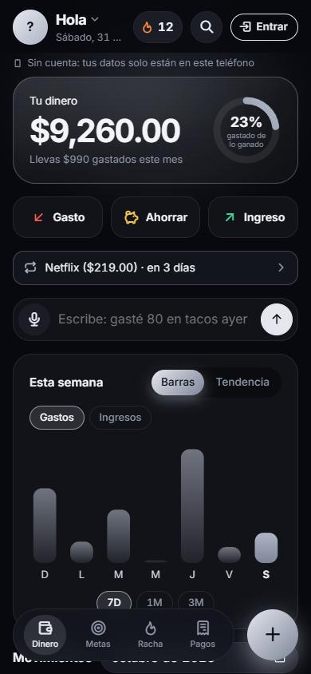
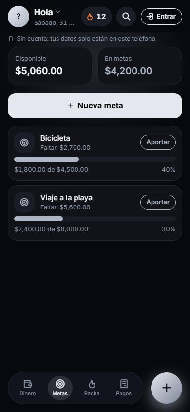
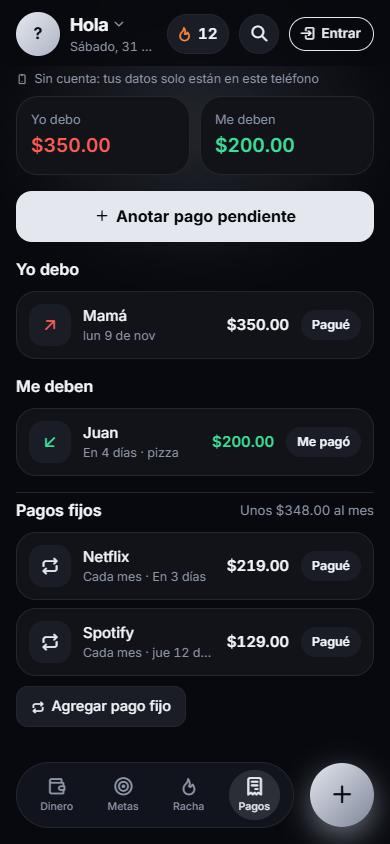

<h1 align="center">Kashiki</h1>

<b>Respira. Ahorra. Crece.</b> 
App para llevar el control de tu dinero desde el teléfono o la computadora.

<a href="https://shanlingsong.github.io/control-dinero/"><b>Abrir Kashiki →</b></a>

  
  
  

## Qué hace

- **Ingresos, gastos y ahorros** con categoría, nota y fecha; gráfica de la semana y del mes, y en qué se va tu dinero.
- **Anotar escribiendo o dictando**: *"gasté 80 en tacos ayer"* o *"me pagaron 2 mil"*. Kashiki saca el monto, el tipo, la categoría y la fecha (con reglas propias, sin IA de pago) y aprende de tus notas anteriores.
- **Metas de ahorro**: apartas dinero para algo y ves cuánto te falta.
- **Racha**: cuenta los días seguidos que registras algo, para crear el hábito.
- **Pagos pendientes**: lo que debes y lo que te deben; al pagarlo se anota solo.
- **Pagos fijos**: Netflix, renta, plan del celular… te avisa antes de cada cobro.
- **Secciones**: separa tu dinero personal del de tu negocio en la misma cuenta.
- **Comparación con el mes pasado** y **búsqueda** de cualquier movimiento.
- **Avisos** por notificación o por Telegram: recordatorio diario y resumen semanal.
- **Exportar a Excel** y respaldo para descargar o restaurar.
- Se instala como app (PWA), **funciona sin internet** y tiene versión para computadora.

## Cómo está hecha

| Parte | Con qué |
| --- | --- |
| App | HTML, CSS y JavaScript sin frameworks, publicada en GitHub Pages |
| Sin internet | Service worker (`sw.js`) y copia de los datos en el teléfono |
| Cuentas y nube | [Supabase](https://supabase.com): inicio de sesión y base de datos Postgres con reglas (RLS) para que cada quien vea solo lo suyo |
| Bot y avisos | Edge Function en Deno (`supabase/functions/kashiki-bot`): bot de Telegram, notificaciones Web Push y tareas programadas con `pg_cron` |

## Archivos

| Archivo | Qué hace |
| --- | --- |
| `index.html` | La estructura de las pantallas |
| `styles.css` | Los colores y el diseño |
| `app.js` | La lógica: guardar, sincronizar, sumar, dibujar |
| `sw.js` | Permite abrirla sin internet |
| `manifest.json` | Nombre e icono para instalarla |
| `privacidad.html` | Aviso de privacidad |
| `supabase/*.sql` | Las tablas y sus reglas de seguridad |
| `supabase/functions/kashiki-bot/` | El servidor: bot de Telegram, notificaciones y borrar cuenta |

## Historia del proyecto

1. ✅ App web básica para el teléfono
2. ✅ Nube con Google Sheets y Apps Script
3. ✅ Metas, racha y avisos por Telegram
4. ✅ Cuentas de usuario con Supabase (varios usuarios, cada quien con sus datos)
5. ✅ Bot propio, notificaciones push, secciones, pagos fijos y anotar dictando
6. ✅ Diseño "Plata", versión para computadora y exportar a Excel

---

Hecho por [shanlingsong](https://github.com/shanlingsong) como proyecto para aprender. © 2026, todos los derechos reservados.
